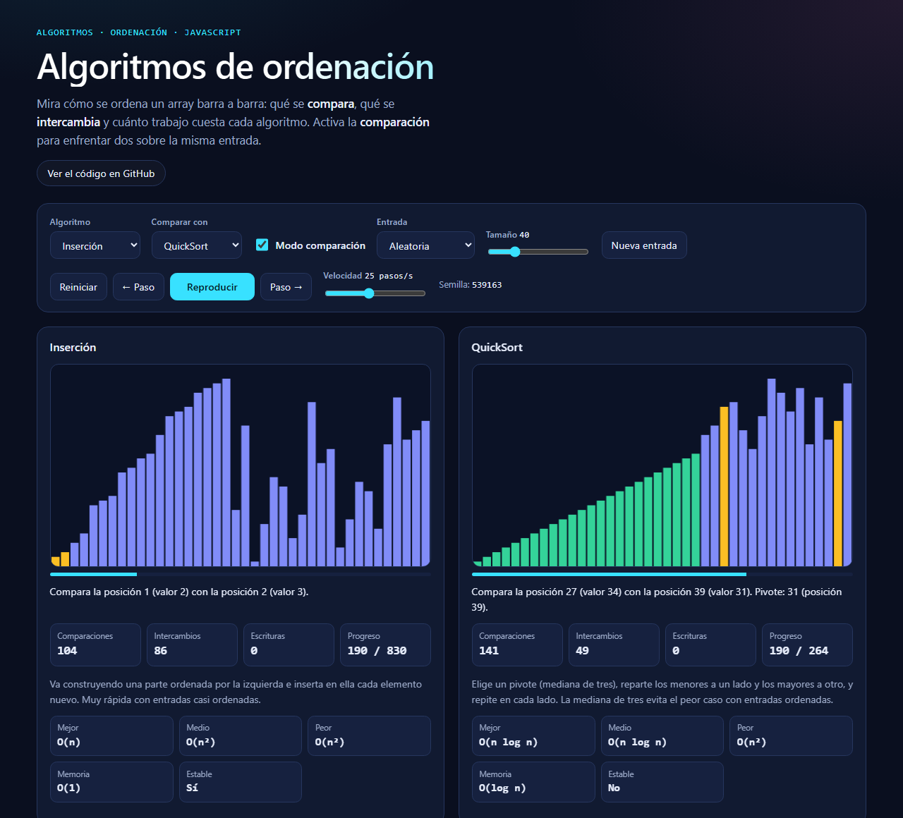

# Visualizador de algoritmos de ordenación

Aplicación web que muestra cómo ordenan un array Burbuja, Selección, Inserción, MergeSort y QuickSort. Cada algoritmo se anima paso a paso con barras que se comparan e intercambian, cuenta las operaciones que realiza y se puede enfrentar a otro sobre la misma entrada.



## Demo

[https://jorge2003rp.github.io/algoritmos-ordenacion](https://jorge2003rp.github.io/algoritmos-ordenacion)

Prueba esto: activa **Modo comparación**, elige **Burbuja** contra **QuickSort**, pon la entrada en **Inversa** y pulsa **Reproducir**.

## Qué hace

- Anima Burbuja, Selección, Inserción, MergeSort y QuickSort paso a paso: qué barras se comparan, cuáles se intercambian o se escriben, cuál es el pivote y qué posiciones ya están en su sitio definitivo. Se puede pausar, avanzar y retroceder de paso en paso y cambiar la velocidad.
- Cuenta comparaciones, intercambios y escrituras reales sobre la entrada elegida, y muestra la complejidad teórica del algoritmo (mejor, medio y peor caso, memoria y estabilidad).
- Permite elegir el tamaño (5 a 150 elementos) y el tipo de entrada: aleatoria, casi ordenada, inversa, con repetidos o ya ordenada. Cada entrada se genera con una semilla, que se muestra en pantalla.
- **Modo comparación**: dos algoritmos a la vez sobre exactamente la misma entrada. Avanzan al mismo ritmo de pasos, así que se ve cuál termina antes, y al acabar se resumen sus contadores.
- Se maneja con el teclado, tiene textos alternativos y una región `aria-live` que describe cada paso, y respeta la preferencia de "reducir movimiento" del sistema (en ese caso no hay animación continua: se avanza paso a paso o se salta al final).

### Controles

| Acción | Cómo |
| --- | --- |
| Reproducir / pausar | Botón o `Espacio` |
| Paso adelante / atrás | Botones o `→` / `←` |
| Cambiar la velocidad | Deslizador o `↑` / `↓` |
| Nueva entrada | Botón o `N` |
| Reiniciar la animación | Botón o `R` |
| Activar el modo comparación | Casilla o `C` |
| Elegir algoritmo | Desplegable o `1`–`5` |

## Tecnologías

HTML, CSS y JavaScript, sin librerías externas ni fuentes externas. El dibujo se hace con `<canvas>`.

## Cómo usarlo

Con la demo online no hace falta instalar nada. Para ejecutarlo en local:

1. Clona el repositorio: `git clone https://github.com/jorge2003rp/algoritmos-ordenacion.git`
2. Abre `index.html` en el navegador.

## Estructura

```
algoritmos-ordenacion/
├── index.html        # Estructura de la página
├── style.css         # Estilos y paleta de colores
├── sorting.js        # Lógica: los cinco algoritmos y el generador de entradas (independiente de la página)
├── sorting.test.js   # Tests automáticos de sorting.js
├── app.js            # Dibujo en canvas, animación, controles y accesibilidad
├── assets/           # Capturas para el README y la vista previa al compartir el enlace
├── package.json      # Script "test" para ejecutar los tests con npm
├── LICENSE           # Licencia MIT
└── README.md
```

La lógica está separada de la interfaz a propósito: `sorting.js` no toca la página, por lo que se puede probar por separado (por ejemplo con Node.js). Cada algoritmo devuelve, además del array ordenado, la lista de pasos que ha dado (`comparar`, `intercambiar`, `escribir`, `pivote`, `fijar`, `fin`); `app.js` solo se dedica a reproducirlos.

## Tests

`sorting.js` tiene tests automáticos escritos con el runner de tests que trae Node.js de serie (sin dependencias externas). Para ejecutarlos:

```
node --test
```

o, si prefieres usar npm:

```
npm test
```

Cada algoritmo se compara con `Array.prototype.sort` en arrays vacíos, de un elemento, con repetidos, ya ordenados, inversos, casi ordenados y aleatorios con semilla fija. Además se comprueba que:

- reproducir los pasos sobre una copia del original da el array ordenado y los contadores coinciden con los pasos;
- los pasos `fijar` solo marcan posiciones que ya tienen su valor final;
- la estabilidad declarada es cierta: Burbuja, Inserción y MergeSort conservan el orden de los empates, y para Selección y QuickSort se encuentran contraejemplos;
- cada variante hace lo que promete: Burbuja se detiene tras una pasada si ya está ordenado, Selección hace siempre n(n−1)/2 comparaciones, MergeSort no pasa de n·⌈log₂ n⌉ y QuickSort no se vuelve cuadrático con entradas ordenadas, inversas o llenas de repetidos.

## Cómo funciona

| Algoritmo | Mejor caso | Caso medio | Peor caso | Memoria extra | Estable |
| --- | --- | --- | --- | --- | --- |
| Burbuja (con parada anticipada) | O(n) | O(n²) | O(n²) | O(1) | Sí |
| Selección | O(n²) | O(n²) | O(n²) | O(1) | No |
| Inserción | O(n) | O(n²) | O(n²) | O(1) | Sí |
| MergeSort | O(n log n) | O(n log n) | O(n log n) | O(n) | Sí |
| QuickSort (mediana de tres) | O(n log n) | O(n log n) | O(n²) | O(log n) | No |

- **Burbuja**: recorre el array comparando vecinos y los intercambia si están al revés; cada pasada deja el mayor al final. Si una pasada completa no intercambia nada, el array ya está ordenado y se detiene, de ahí su mejor caso O(n).
- **Selección**: busca el mínimo de la parte sin ordenar y lo intercambia con la primera posición libre. Hace como mucho n − 1 intercambios, pero siempre las mismas comparaciones. No es estable porque ese intercambio puede saltarse a elementos iguales.
- **Inserción**: mantiene ordenado el principio del array y hace "retroceder" cada elemento nuevo, con intercambios, hasta su sitio. Con entradas casi ordenadas apenas trabaja.
- **MergeSort**: divide el array por la mitad, ordena cada mitad y las mezcla con un buffer auxiliar. En un empate gana el elemento de la izquierda, lo que lo hace estable. Las comparaciones se hacen sobre el array sin tocar y el resultado se vuelca después, por eso en pantalla se ven como escrituras y no como intercambios.
- **QuickSort**: ordena entre sí el primero, el del medio y el último (mediana de tres), usa la mediana como pivote y reparte los menores a un lado y los mayores al otro. Elegir así el pivote evita el peor caso con entradas ordenadas o inversas, aunque una entrada construida a propósito todavía podría provocarlo. La recursión se hace solo sobre la parte pequeña, así que la pila no pasa de O(log n).

Los contadores de la animación no son la cota teórica sino operaciones reales: por eso Burbuja con una entrada ya ordenada marca n − 1 comparaciones y ningún intercambio, y con una inversa marca n(n − 1)/2 de cada.

## Qué aprendí

<!-- TODO: redactar a mano -->
- 
- 
- 
<!-- /TODO -->

## Posibles mejoras

- Visualizar también la búsqueda lineal y la binaria (iterativa y recursiva)
- Más algoritmos (Shell, HeapSort, ordenación por cuentas)
- Un modo de sonido, con un tono distinto según el valor comparado
- Introducir tu propio array
- Gráfica de tiempos reales para tamaños crecientes

## Referencias y atribución

Las implementaciones y los textos de este repositorio son propios. Como fuente de referencia para los algoritmos se han consultado los apuntes y ejemplos de la asignatura ADSW de la UPM, que se distribuyen bajo licencia [CC BY-NC-SA 3.0](https://creativecommons.org/licenses/by-nc-sa/3.0/deed.es). No se ha copiado su código ni sus diapositivas.

## Licencia

MIT. Consulta el archivo [LICENSE](LICENSE).
